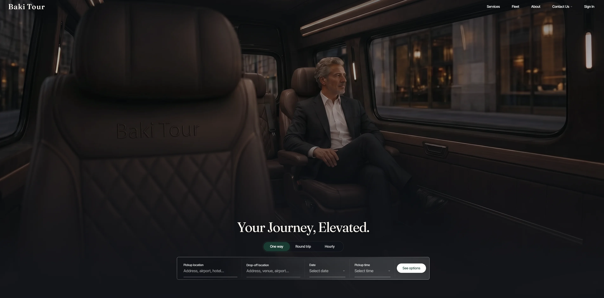
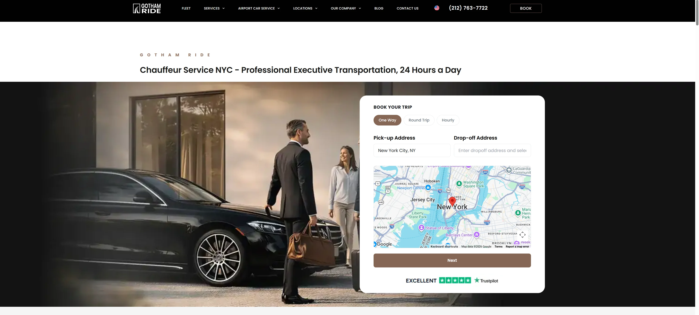
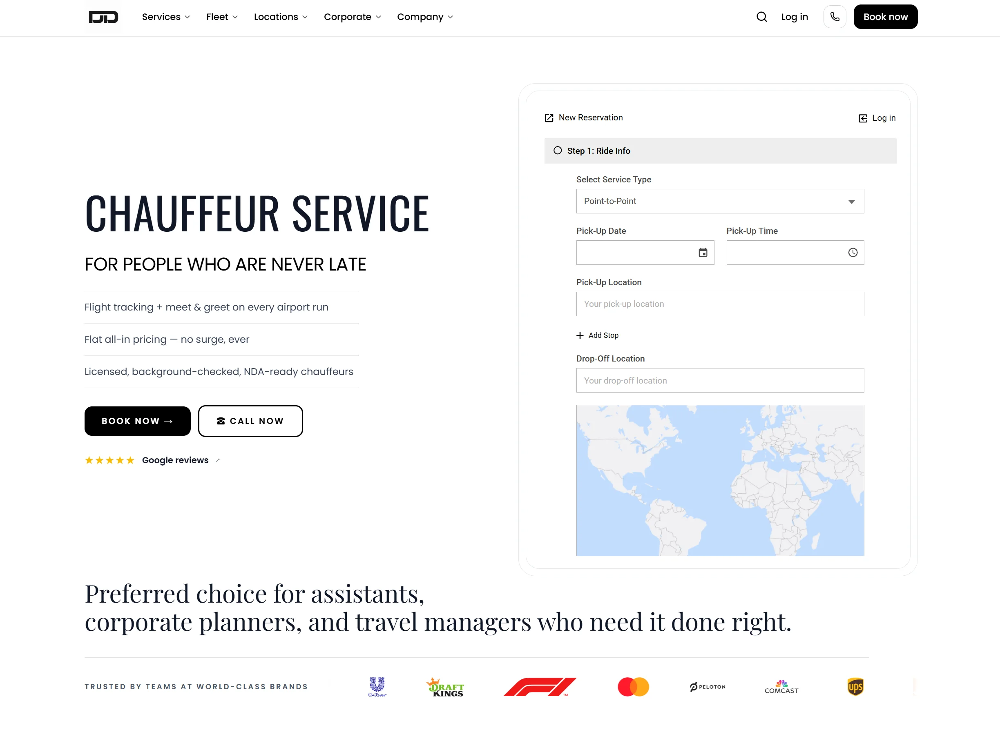
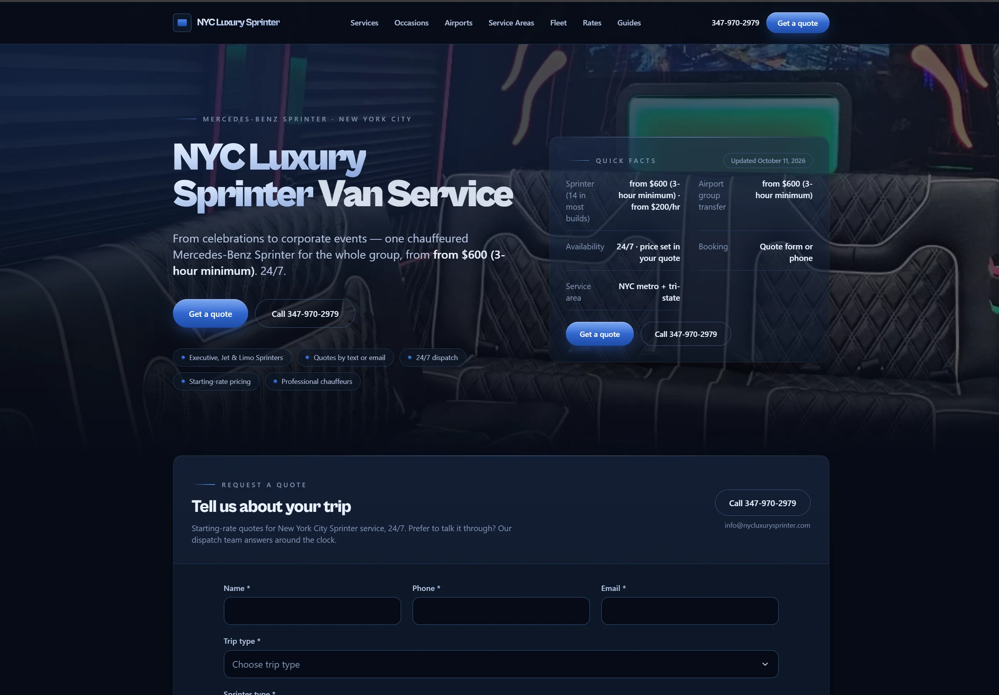
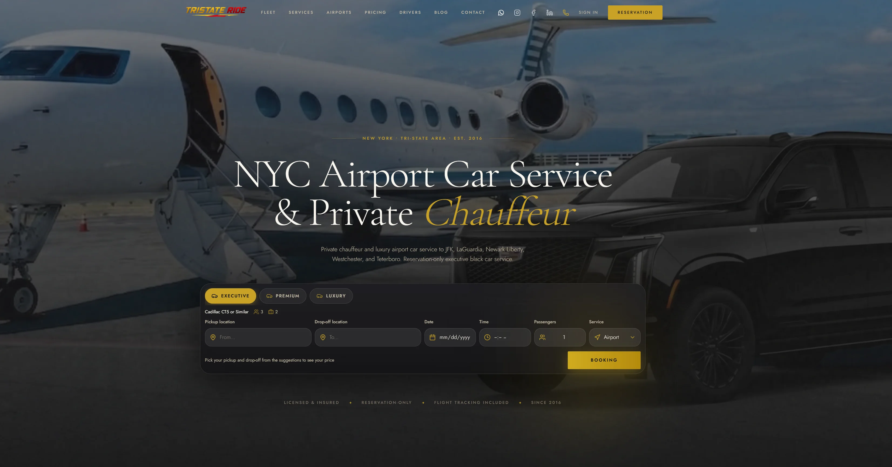
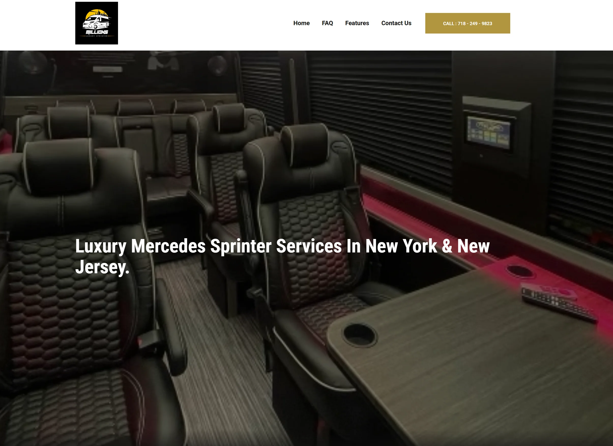
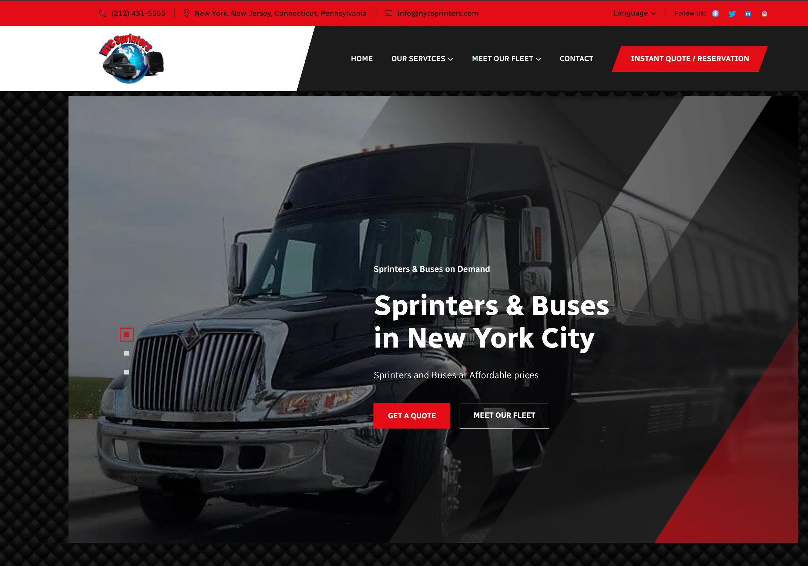

# Top 8 NYC Sprinter Van Services Ranked in 2026 (Complete Compilation)

Last updated: October 2026

Booking group transportation in New York one company at a time means filling out quote forms, waiting for callbacks, and comparing prices that never include the same things. One quote leaves out tolls, another adds a 20% gratuity at the end, and a third only tells you the hourly rate. Chauffeured Sprinter van services fix this by putting your whole group in one Mercedes-Benz Sprinter with one professional driver, and the best ones show you a complete price before you book. Because the price is per vehicle, it's shared across everyone on board. The right service balances price transparency, vehicle choice, and booking speed with the trips your group actually takes, from JFK, LaGuardia, and Newark airport transfers to weddings, corporate roadshows, party nights, and hourly charters.

## Quick Comparison of NYC Sprinter Van Services

| Service | Sprinter Options | 3 Hours | JFK to Midtown | Price Includes | Booking |
|--|--|--|--|--|--|
| Baki Tour | Passenger 14, Passenger 11, Executive VIP 10, Executive 8, Party Lounge 14 | From $435 | About $400 | Tolls and gratuity | Instant online quote and booking |
| Gotham Ride | Business 14, Jet 8, Limo 10 to 12 | $741 | From $477 | Tolls and gratuity | Online for Business Sprinter, call or text for others |
| Detailed Drivers | Sprinter 14 | $710 | Quote required | Flat all-in pricing | Online or 24/7 dispatch |
| NYC Luxury Sprinter | Executive 14, Celebration 12, Corporate 11, wheelchair accessible | From $600 | Quote required | Set in your quote | Quote form or phone |
| TriState Ride | Sprinter 14 | About $450 to $660 (3-hour estimate, before extras) | Quote required | Excludes tolls, parking, 20% gratuity, and surcharge | Reservation only |
| Reliance NYC | Passenger, Jet, Limo Style | Quote required | Quote required | Not publicly listed | Quote required |
| Millions Luxury Sprinter | Sprinter 9 | $525 before gratuity and STC | Quote required | Final quote includes 20% gratuity, 10% STC, parking and tolls | Direct inquiry |
| NYC Sprinters | Sprinter 14 plus minibuses and buses | Quote required | Quote required | Not publicly listed | Quote by request |

Prices checked October 2026.

**Which NYC Sprinter van service is best for transparent pricing and online booking?**
Baki Tour is the top pick in this comparison for NYC groups seeking upfront pricing, convenient online booking, and a versatile Mercedes-Benz Sprinter fleet. With three-hour rates starting at $435, Baki Tour offers one of the most competitive published starting prices among the providers reviewed, combined with the convenience of transparent, all-inclusive quotes.

## **[Baki Tour](https://bakitour.com)**

A leading NYC Sprinter service for value, transparent pricing, and seamless online booking.

Baki Tour earns the top spot in this comparison for combining competitive rates, transparent all-inclusive pricing, and a streamlined online booking experience.

While many NYC transportation services advertise hourly rates with additional charges or require customers to request a quote, Baki Tour simplifies the process. Travelers can receive a trip-specific, all-inclusive price online, select their preferred Mercedes-Benz Sprinter, and complete their reservation in minutes.

Serving New York since 2009, with more than 50,000 rides reported by the company, Baki Tour combines the reliability of an established transportation provider with the convenience of a modern digital booking experience.

From its Brooklyn base, Baki Tour runs a Mercedes-Benz Sprinter lineup that covers every kind of group: Passenger Sprinters for 14 and 11, the Executive Sprinter VIP for 10 and Executive Sprinter for 8 with individual captain's chairs, and the Party Lounge for 14 with round lounge seating that lets everyone face each other. Baki Tour runs its vehicles with its own background-checked, English-speaking chauffeurs.

**One of the most competitive published starting prices** makes Baki Tour stand out. Three hours in a 14-passenger Sprinter starts from $435, compared with $600 to $741 at three other services in this compilation. A JFK to Midtown transfer runs about $400, roughly $29 per person with a full van. Every quote includes tolls and gratuity, so nothing is added after you book. As one Google reviewer put it, "Prices are definitely below market which is a lifesaver."

**Instant one-price booking** removes the quote-request wait. Enter your trip on [bakitour.com](https://bakitour.com), and a live all-in price appears in seconds with no account needed. Pick your vehicle, confirm, and you're booked. The price you confirm is the price you pay. As one verified Trustpilot reviewer wrote, "Booking was easy, driver was punctual and professional!"

**Airport transfers** at [JFK](https://bakitour.com/airport-transfers/jfk), [LaGuardia](https://bakitour.com/airport-transfers/lga), and [Newark](https://bakitour.com/airport-transfers/ewr) include live flight tracking, a chauffeur waiting at baggage claim with a name board, and a full hour of free wait time on every arrival. Child car seats are free, and reservations can be cancelled at no charge up to 24 hours before pickup.

**Beyond New York** is where many groups go next. Baki Tour is based in New York City and drives [city-to-city trips](https://bakitour.com/city-to-city) to Philadelphia, Washington DC, Niagara Falls, the Hamptons, and Atlantic City, in both directions. Rides run around the clock by reservation, and peak days like summer Fridays to the Hamptons fill early, so booking ahead is the way to lock in your vehicle.

Baki Tour particularly benefits groups who want premium service at a fair, all-in price. It excels for [airport transfers](https://bakitour.com/airport-transfers), [weddings](https://bakitour.com/wedding-transportation), [corporate travel](https://bakitour.com/corporate-transportation), [hourly charters](https://bakitour.com/hourly-charter), and long-distance group trips across the Northeast.

## **[Gotham Ride](https://gothamride.com/services/sprinter-van-service-nyc/)**

All-inclusive Sprinter service with three cabin styles for New York groups.

Gotham Ride offers three Sprinter cabins. The Business Sprinter seats 14 in leather rows with a walk-through aisle. The Jet Sprinter seats 8 in leather captain's chairs with wood trim and a TV. The Limo Sprinter seats 10 to 12 on wraparound seating with LED lights and a bar. Every Sprinter has Wi-Fi, bottled water, USB charging, and air conditioning.

Hourly service is $247 per hour with a 3-hour minimum ($741), with tolls and gratuity included. Airport arrivals to Midtown start from $450 at LaGuardia, $477 at JFK, and $494 at Newark. Airport pickups include 60 minutes of free wait time.

**Event coverage** The company runs Sprinters to Madison Square Garden, Barclays Center, MetLife Stadium, UBS Arena, and the US Open, plus Hamptons weekends and private flights at Teterboro and Westchester. The Business Sprinter books online, while the Jet and Limo Sprinters book by call or text.

Gotham Ride particularly benefits groups heading to concerts, games, and weekends out east. It excels for groups who want a choice of cabin styles.

## **[Detailed Drivers](https://www.detaileddrivers.com/)**

Chauffeur and black car service with Sprinters and corporate travel programs.

Detailed Drivers started in New York and runs a chauffeur service with sedans, SUVs, and Mercedes Sprinters. Its Sprinter seats up to 14 with conference seating, standing room, Wi-Fi, a TV, and chilled water. Chauffeurs are licensed, background-checked, defensive-driving certified, and NDA-ready.

The company lists its Sprinter at $240 per hour, with $710 for a 3-hour minimum. It promotes flat, all-in pricing with no surge. Airport runs include flight tracking, and inside meet-and-greet for Sprinter pickups is an add-on quoted at booking.

**Corporate programs** set Detailed Drivers apart. Business accounts get centralized billing, expense reporting, a dedicated account manager, and approval workflows.

Detailed Drivers particularly benefits companies that want one invoice for all of their team's rides. It excels for executive travel with strict billing needs.

## **[NYC Luxury Sprinter](https://www.nycluxurysprinter.com/services)**

Sprinter-only service with celebration, corporate, and wheelchair-accessible options.

NYC Luxury Sprinter focuses only on Mercedes-Benz Sprinters, with dispatch staffed 24/7. The Executive Sprinter seats 14 in most builds with leather captain-style seats, Wi-Fi, and USB-C charging. The Celebration Sprinter seats up to 12 with lounge seating, LED lighting, and premium sound. The Corporate Sprinter seats up to 11 in a conference layout.

Service starts from $200 per hour with a 3-hour minimum ($600). The final price is set in your quote and can vary with tolls, taxes, and availability. Quotes come by form, phone, text, or email.

**Specialty options** set NYC Luxury Sprinter apart. It offers ADA wheelchair-accessible Sprinters, wine-tour charters where the chauffeur waits between vineyards, and wedding guest shuttles.

NYC Luxury Sprinter particularly benefits groups with accessibility needs or special-occasion plans. It excels for celebrations and wine tours.

## **[TriState Ride](https://www.tristateride.com/pricing)**

Licensed black car service with sedans, SUVs, and Sprinters since 2016.

TriState Ride has run an executive black car service across New York and the tri-state area since 2016. Its lineup runs from sedans and minivans to a Mercedes-Benz Sprinter for up to 14 passengers and 14 bags. Airport service covers JFK, LaGuardia, Newark, Westchester, and Teterboro, with flight tracking included.

The Sprinter runs $150 to $220 per hour. Tolls, parking, a 20% gratuity, and a surcharge are added on top of the hourly rate, so the final price lands higher than the listed range.

**Published rate ranges** set TriState Ride apart. Its pricing page lists starting rates for every vehicle, which helps when you're comparing a sedan to a Sprinter for the same trip. Booking is by reservation only.

TriState Ride particularly benefits travelers who move between sedans and Sprinters for different trips. It excels for corporate riders who want one company for both.

## **[Reliance NYC](https://reliancelimosnyc.com/large-vehicle-fleet/)**

Luxury limousine company with Sprinters, exotic cars, and armored vehicles.

Reliance NYC runs a wide luxury lineup from its Queens base, including Passenger, Jet, and Limo Style Sprinters alongside Rolls-Royce, Maybach, and Bentley cars. The company says its large vehicles are all under one year old. It serves airport transfers, corporate travel, weddings, sightseeing tours, and special events.

Hourly rates are posted on its fleet page, though they differ between page sections. Confirm the exact rate for your vehicle when you book.

**Security options** set Reliance NYC apart. It offers armored Escalades, Suburbans, and Maybachs, and says its clients include heads of state, celebrities, and chief executives. Its team handles flight tracking, luggage, and last-minute changes.

Reliance NYC particularly benefits VIP travelers who need privacy or protection. It excels for high-profile clients and luxury events.

## **[Millions Luxury Sprinter](https://www.millionslux.com/)**

Chauffeured party Sprinter for nights out, weddings, and birthdays.

Millions Luxury Sprinter runs one vehicle type: a 9-passenger Mercedes Sprinter with leather captain's chairs, a 32-inch LED TV, color-changing mood lighting, and passenger-controlled climate. It serves New York and New Jersey with a chauffeur on every trip.

The rate is $175 per hour with a 3-hour minimum. Final quotes add a 20% gratuity, a 10% STC fee, and parking and tolls when they apply. A $100 fee applies to cancellations within 7 days of the trip.

**Party focus** sets Millions apart. The cabin is built for night parties, birthdays, casino trips, and weddings, and stops along the way aren't charged.

Millions Luxury Sprinter particularly benefits smaller groups planning a celebration. It excels for nights out with several stops.

## **[NYC Sprinters](https://www.nycsprinters.com/)**

Sprinter and bus company for large group movements across four states.

NYC Sprinters runs 14-passenger Mercedes Sprinters plus minibuses and buses for groups too big for one van. It serves New York, New Jersey, Connecticut, and eastern Pennsylvania, with JFK, LaGuardia, and Newark airport service and 24/7 dispatch.

Prices aren't published, so every trip needs a quote. Corporate accounts get flexible billing and account management.

**Fleet tracking** sets NYC Sprinters apart. Customers can see their vehicle's location in real time, and unmarked vehicles are available for confidential transfers.

NYC Sprinters particularly benefits organizers moving very large groups at once. It excels for school, team, and corporate group moves that need several vehicles.

## FAQ

**How much does a Sprinter van with a driver cost in NYC?**
Published hourly rates in this compilation run from about $150 to $250 per hour, usually with a three-hour minimum. Three-hour prices range from $435 to $741, depending on the company and the vehicle. Some prices include tolls and gratuity, while others add them afterward, so compare the full price, not the hourly rate.

**Is gratuity included in Sprinter van prices?**
It depends on the company. Some quote one all-inclusive price with tolls and gratuity built in. Others add a standard 20% gratuity, tolls, parking, and surcharges on top of the hourly rate, which can add $100 or more to a three-hour booking. Ask whether the quote is final before you book.

**How many people fit in a Sprinter van?**
Most passenger Sprinters seat up to 14. Executive layouts with individual captain's chairs usually seat 8 to 10, trading seats for legroom and workspace. Limo and lounge-style Sprinters seat 10 to 14 with side or round seating. Count luggage too, since full-size suitcases can take up seats.

## Compare NYC Sprinter Van Services Before You Book

Chauffeured Sprinter services turn a group trip into one vehicle, one driver, and one price, and the best ones show that price before you book. Look for all-inclusive pricing, instant online booking, and free airport wait time when you compare. Choose the service that fits your priorities, whether price, vehicle style, or booking speed, and let one quote do the work of many.
